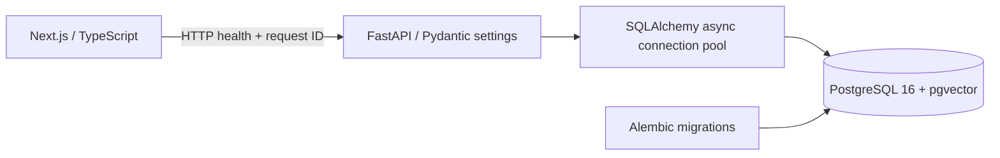

# Architecture

Phase 0 establishes the local monorepo. Browser UI and API are independent processes; PostgreSQL is the single persistent store. Inference and embedding packages are deliberately absent from the web process.

The database connection pool has five connections and five overflow slots per API process. Health requests have a three-second overall timeout. Lifespan startup probes connectivity and shutdown disposes the pool. Database unavailability leaves the process live while readiness returns 503, allowing a database restart to recover without an API restart. Invalid configuration prevents app construction.

The first migration creates the vector extension. The database user must have extension creation rights when migrations run. Runtime only checks capabilities. Domain tables and indexes are introduced with ingestion/indexing rather than as unused speculative schemas. The initial downgrade preserves the potentially shared extension.

Future phases add temporary PDF parsing, durable chunks and sessions, provider interfaces, retrieval evaluation, citation verification, and bounded agent jobs in that order. Session isolation and quotas must be implemented before enabling uploads or chat. No worker or agent is running in Phase 0.

The frontend uses a quiet blue/white research notebook direction: paper `#f5f7fa`, ink `#173747`, blue `#246181`, rule `#d6e0e7`, muted `#526572`, connected `#23714c`. Georgia headlines and Segoe UI body text avoid remote font downloads. A left-aligned workspace introduction pairs with a live connection sheet; no fabricated research results are displayed.

Implementation references: [Next.js installation](https://nextjs.org/docs/app/getting-started/installation), [Pydantic settings](https://docs.pydantic.dev/latest/concepts/pydantic_settings/), [SQLAlchemy asyncio](https://docs.sqlalchemy.org/en/20/orm/extensions/asyncio.html), [pgvector](https://github.com/pgvector/pgvector).
