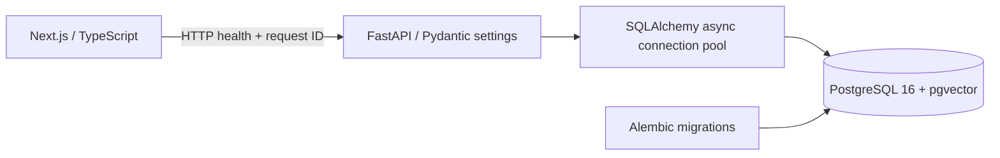

# Architecture

Phase 0 establishes the local monorepo. Browser UI and API are independent processes; PostgreSQL is the single persistent store. Inference and embedding packages are deliberately absent from the web process.

The database connection pool has five connections and five overflow slots per API process. Health requests have a three-second overall timeout. Lifespan startup probes connectivity and shutdown disposes the pool. Database unavailability leaves the process live while readiness returns 503, allowing a database restart to recover without an API restart. Invalid configuration prevents app construction.

The first migration creates the vector extension. The database user must have extension creation rights when migrations run. Runtime only checks capabilities. Domain tables and indexes are introduced with ingestion/indexing rather than as unused speculative schemas. The initial downgrade preserves the potentially shared extension.

Future phases add temporary PDF parsing, durable chunks and sessions, provider interfaces, retrieval evaluation, citation verification, and bounded agent jobs in that order. Session isolation and quotas must be implemented before enabling uploads or chat. No worker or agent is running in Phase 0.

Phase 1 steps 1-2 now provide an internal pipeline: bounded validation stages a UUID-named temporary PDF, then PyMuPDF4LLM extracts immutable page-numbered Markdown results. The geometric backend avoids loading the ONNX layout model. Selected decorative fills outside detected tables are removed only from the in-memory PDF copy to retain shaded text; the original input stays unchanged. Native document handles close before temporary-file cleanup. The local CLI can explicitly export results as UTF-8 JSON. No upload route, persistent document tables, OCR, or background worker is active yet. See the [extraction guide](<phases guide/phase-1/phase-1-step-2-layout-aware-extraction.md>).

Step 3 adds a native-text preflight before layout analysis: count printable non-whitespace characters per page and reject once pages below the configured minimum exceed the whole-document percentage allowance. Default boundaries are strictly fewer than 50 characters and strictly more than 80% of pages. A typed `OCR_NOT_SUPPORTED` failure reaches the CLI as `status: "failed"`; successful extraction includes an immutable text-density report. Persistent document status updates await document/job records. See the [detection guide](<phases guide/phase-1/phase-1-step-3-scanned-pdf-detection.md>).

Steps 4-6 extend this with `prepare()`: conservative repeated-boundary removal produces a separate normalized representation and original-character mappings, then a Markdown-aware chunker builds single-page source spans using a bundled offline `cl100k_base` tokenizer. PostgreSQL now stores `Document` metadata/status through migration `0002_documents`. The startup database check transactionally fails stale queued/processing rows once, with retry after database unavailability. Chunk/vector persistence and the public upload lifecycle remain Phase 2/integration work. The [phase guides](<phases guide/README.md>) describe boundaries, token exceptions, and verification.

The frontend uses a quiet blue/white research notebook direction: paper `#f5f7fa`, ink `#173747`, blue `#246181`, rule `#d6e0e7`, muted `#526572`, connected `#23714c`. Georgia headlines and Segoe UI body text avoid remote font downloads. A left-aligned workspace introduction pairs with a live connection sheet; no fabricated research results are displayed.

Implementation references: [Next.js installation](https://nextjs.org/docs/app/getting-started/installation), [Pydantic settings](https://docs.pydantic.dev/latest/concepts/pydantic_settings/), [SQLAlchemy asyncio](https://docs.sqlalchemy.org/en/20/orm/extensions/asyncio.html), [pgvector](https://github.com/pgvector/pgvector).
