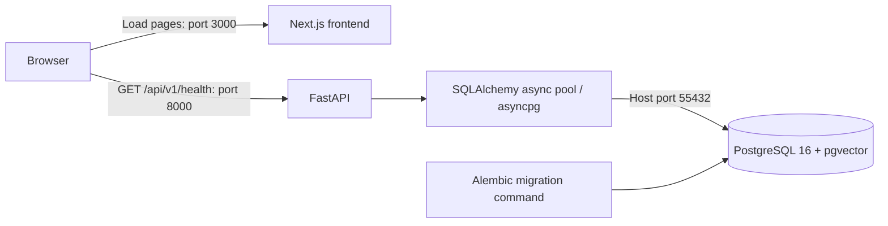
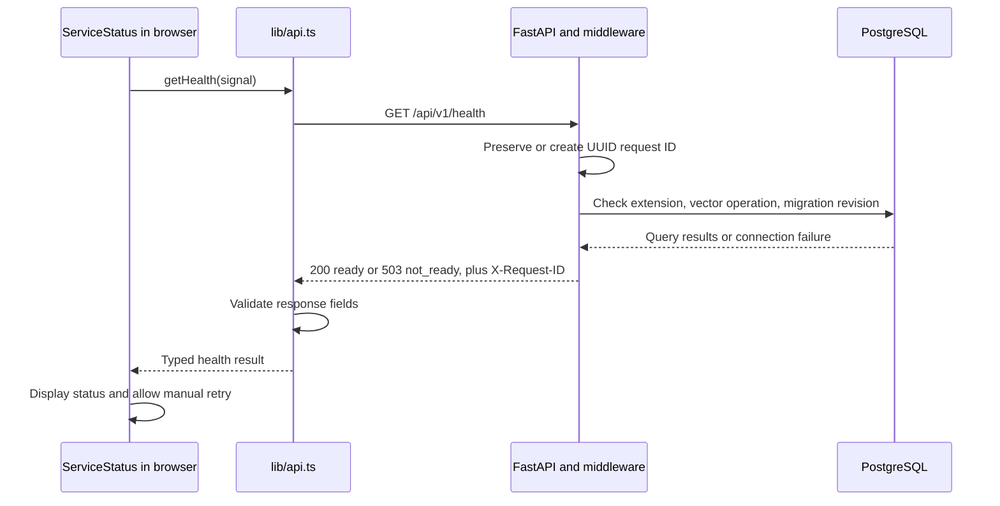

# Phase 0: Project foundation

Documented: 15 November 2026. Implementation and acceptance results recorded: 14 November 2026.

Phase 0 established a runnable monorepo for the Agentic Research & Knowledge Assistant. The browser application, API, and database can run locally, and the frontend can display the API's real connection status. This guide explains the changes, where the code lives, and how it works.

## 1. Changes delivered in Phase 0

| Area | What was added | Purpose |
| --- | --- | --- |
| Repository | `apps/web`, `apps/api`, `data`, `scripts`, `docs`, and CI directories | Keep the frontend, backend, data, and engineering documentation together. |
| Frontend | Next.js 16.4.6, React 19.3.1, TypeScript, shared layout, and four routes | Establish navigation and a research workspace shell. |
| Connection UI | Typed health client and `ServiceStatus` component | Show actual database readiness, connection failures, and manual retry. |
| Backend | FastAPI application factory and lifespan management | Construct the API, initialize its dependencies, and release connections on shutdown. |
| Configuration | Pydantic Settings, environment templates, and sanitized startup validation | Validate required configuration before the API starts. |
| Logging | JSON formatter and request correlation middleware | Trace requests by UUID without recording query strings or raw exception details. |
| Database | PostgreSQL 16 with pgvector in Docker Compose | Provide persistent local database infrastructure. |
| Pooling | SQLAlchemy asynchronous engine and session factory using asyncpg | Reuse database connections rather than opening a new connection for every operation. |
| Migrations | Alembic setup and `0001_pgvector` migration | Enable the vector extension through an explicit, versioned migration. |
| Health endpoints | Separate liveness and readiness routes | Distinguish an active API process from a working database connection. |
| Quality checks | Ruff, mypy, pytest, ESLint, TypeScript, and production build commands | Catch code, configuration, and integration errors. |
| CI | GitHub Actions backend and frontend jobs | Run the foundation checks on pushes and pull requests. |
| Packaging | Backend Dockerfile, lockfiles, and ignore rules | Support repeatable installation and keep local secrets out of source and images. |
| Documentation | Setup instructions, architecture, API contracts, threat model, and acceptance report | Explain how to run, verify, and extend the foundation. |

During implementation, the embedding dimension setting was adjusted to accept environment strings while still enforcing exactly 384 dimensions. Test import paths were configured explicitly. Request logging was verified with the complete API route, and frontend type checking was updated to generate Next.js route types before running TypeScript.

The frontend production build uses Webpack, one build worker, and memory optimizations after the initial build encountered host memory pressure. The optional Node heap settings in the run instructions describe the local workaround.

## 2. File structure

The tree below shows the application source and project configuration. Dependency folders, caches, generated build output, temporary verification files, and most empty `__init__.py` files are omitted. Directories marked `reserved` contain placeholders for future phases.

```text
New folder/
|-- .github/
|   `-- workflows/
|       `-- ci.yml
|-- .env.example
|-- .gitattributes
|-- .gitignore
|-- README.md
|-- compose.yaml
|-- runGuide.txt                         # Local run notes supplied after Phase 0
|-- apps/
|   |-- api/
|   |   |-- .dockerignore
|   |   |-- .python-version
|   |   |-- Dockerfile
|   |   |-- alembic.ini
|   |   |-- pyproject.toml
|   |   |-- uv.lock
|   |   |-- app/
|   |   |   |-- main.py
|   |   |   |-- api/v1/health.py
|   |   |   |-- core/
|   |   |   |   |-- config.py
|   |   |   |   |-- logging.py
|   |   |   |   `-- middleware.py
|   |   |   |-- db/
|   |   |   |   |-- base.py
|   |   |   |   `-- session.py
|   |   |   |-- schemas/                 # Reserved
|   |   |   |-- services/
|   |   |   |   |-- ingestion/           # Reserved
|   |   |   |   |-- chunking/            # Reserved
|   |   |   |   |-- providers/           # Reserved
|   |   |   |   |-- retrieval/           # Reserved
|   |   |   |   |-- generation/          # Reserved
|   |   |   |   `-- evaluation/          # Reserved
|   |   |   |-- agents/
|   |   |   |   |-- nodes/               # Reserved
|   |   |   |   `-- tools/               # Reserved
|   |   |   `-- workers/                 # Reserved
|   |   |-- migrations/
|   |   |   |-- env.py
|   |   |   |-- script.py.mako
|   |   |   `-- versions/
|   |   |       `-- 0001_enable_pgvector.py
|   |   `-- tests/
|   |       |-- conftest.py
|   |       |-- unit/
|   |       |   |-- test_config.py
|   |       |   `-- test_health.py
|   |       |-- integration/
|   |       |   `-- test_database.py
|   |       `-- evaluation/              # Reserved
|   `-- web/
|       |-- .env.example
|       |-- package.json
|       |-- package-lock.json
|       |-- next.config.ts
|       |-- next-env.d.ts
|       |-- tsconfig.json
|       |-- eslint.config.mjs
|       |-- app/
|       |   |-- layout.tsx
|       |   |-- globals.css
|       |   |-- page.tsx
|       |   |-- workspace/page.tsx
|       |   |-- documents/page.tsx
|       |   `-- research/[id]/page.tsx
|       |-- components/
|       |   |-- service-status.tsx
|       |   |-- chat/                    # Reserved
|       |   |-- documents/               # Reserved
|       |   |-- citations/               # Reserved
|       |   `-- research/                # Reserved
|       `-- lib/
|           `-- api.ts
|-- data/
|   |-- samples/README.md
|   |-- eval/README.md
|   `-- fixtures/README.md
|-- scripts/
|   `-- check_health.py
`-- docs/
    |-- architecture.md
    |-- api-contracts.md
    |-- evaluation-report.md
    |-- threat-model.md
    `-- phases guide/
        |-- README.md
        |-- phase-0/
        |   |-- README.md
        |   `-- phase-0-project-foundation.md
        `-- phase-1/                     # Later-phase guides
```

The supplied implementation-guide PDF also remains in the repository root. The local root `.env`, `apps/api/.venv`, `apps/web/node_modules`, and `apps/web/.next` are ignored by Git. `.gitkeep` files preserve otherwise empty directories; they do not implement a service.

## 3. Important files and their responsibilities

### Backend

| File | Responsibility |
| --- | --- |
| [app/main.py](../../../apps/api/app/main.py) | Defines `create_app()`, creates the exported `app`, attaches settings and database state, installs middleware, and registers routes. |
| [core/config.py](../../../apps/api/app/core/config.py) | Reads the root `.env`, validates settings, masks secrets, and reports invalid field names safely. |
| [core/logging.py](../../../apps/api/app/core/logging.py) | Formats application events as JSON and stores the current request ID in a `ContextVar`. |
| [core/middleware.py](../../../apps/api/app/core/middleware.py) | Preserves or creates a UUID, adds `X-Request-ID`, measures latency, and produces generic responses for unhandled errors before a response has started. |
| [api/v1/health.py](../../../apps/api/app/api/v1/health.py) | Defines the readiness response model and the two health endpoints. |
| [db/session.py](../../../apps/api/app/db/session.py) | Owns the async engine, session factory, connection checks, and engine disposal. |
| [db/base.py](../../../apps/api/app/db/base.py) | Provides the shared SQLAlchemy declarative base; application tables are added in later phases. |
| [migrations/env.py](../../../apps/api/migrations/env.py) | Connects Alembic to the configured database and SQLAlchemy metadata. |
| [0001_enable_pgvector.py](../../../apps/api/migrations/versions/0001_enable_pgvector.py) | Runs `CREATE EXTENSION IF NOT EXISTS vector` and records migration revision `0001_pgvector`. |
| [pyproject.toml](../../../apps/api/pyproject.toml) | Declares dependencies and configures Ruff, mypy, and pytest. |
| [uv.lock](../../../apps/api/uv.lock) | Records resolved Python dependencies for frozen installation. |
| [Dockerfile](../../../apps/api/Dockerfile) | Builds a Python 3.12 API image with runtime dependencies and a non-root runtime user. |

### Frontend

| File | Responsibility |
| --- | --- |
| [app/layout.tsx](../../../apps/web/app/layout.tsx) | Provides page metadata, navigation, skip link, shared page container, and footer. |
| [app/globals.css](../../../apps/web/app/globals.css) | Defines the research workspace's colors, typography, layouts, focus styles, and responsive rules. |
| [app/page.tsx](../../../apps/web/app/page.tsx) | Renders the home page with a workspace link and connection panel. |
| [app/workspace/page.tsx](../../../apps/web/app/workspace/page.tsx) | Renders the empty workspace and live connection panel. |
| [app/documents/page.tsx](../../../apps/web/app/documents/page.tsx) | Explains the document library's current empty state. |
| [app/research/[id]/page.tsx](../../../apps/web/app/research/[id]/page.tsx) | Provides a research route shell; it does not load or execute a research job. |
| [components/service-status.tsx](../../../apps/web/components/service-status.tsx) | Fetches readiness on mount, handles a five-second timeout, shows the result, and supports manual retry. |
| [lib/api.ts](../../../apps/web/lib/api.ts) | Defines the `Health` type, resolves the API base URL, and validates the health response at runtime. |
| [package.json](../../../apps/web/package.json) | Defines development, production, lint, and type-check commands and frontend dependencies. |
| [package-lock.json](../../../apps/web/package-lock.json) | Records the dependency tree consumed by `npm ci`. |
| [next.config.ts](../../../apps/web/next.config.ts) | Enables React strict mode, disables the powered-by header, and limits production build workers. |

## 4. How the project works

### Three cooperating processes

Next.js serves the browser interface on port 3000. FastAPI serves JSON and API documentation on port 8000. PostgreSQL runs in Docker and exposes its container port 5432 on the host's `127.0.0.1:55432`.

The browser's connection component calls FastAPI directly using the API base URL. The health request is not proxied through a Next.js API route.



### Backend startup and shutdown

1. Uvicorn imports `app.main:app`.
2. `create_app()` loads and validates settings. Missing or invalid required settings raise a sanitized error and prevent startup.
3. Application logging, versioned health routes, request middleware, and CORS are configured.
4. FastAPI's lifespan creates `Database` and stores it on `app.state.database`.
5. A startup probe checks the database. A successful probe produces a readiness event. An unsuccessful probe produces a generic warning while leaving the API process available.
6. Requests can now use the shared engine. Each readiness request performs a fresh check, allowing recovery after a database outage.
7. On shutdown, the engine is disposed and the lifespan logs completion.

Migrations run separately with `uv run alembic upgrade head`. Starting the API does not create extensions or apply migrations automatically.

### A health request from browser to database



The client accepts both 200 and 503 as health responses so the UI can explain a database problem. Other HTTP statuses, invalid response bodies, network failures, and timeouts take the error path. Requests use `cache: "no-store"` and `credentials: "include"`; the latter prepares the client for cookies, but Phase 0 does not implement anonymous session cookies.

### Liveness and readiness

| Endpoint | Success | Failure behavior |
| --- | --- | --- |
| `GET /api/v1/health/live` | HTTP 200 with `{"status":"alive"}` | Does not access the database; a database outage does not make this route fail. |
| `GET /api/v1/health` | HTTP 200 with database and pgvector status | HTTP 503 with `status: "not_ready"`, `db: "unavailable"`, and `pgvector: null`. |

Readiness verifies three things: the `vector` extension is installed, an actual vector distance operation succeeds, and `alembic_version` matches `0001_pgvector`. Its overall database-check timeout defaults to three seconds. Both endpoints return `Cache-Control: no-store`.

A successful response has this shape; the installed pgvector version can vary:

```json
{
  "status": "ready",
  "db": "connected",
  "pgvector": "0.8.7",
  "embedding_model": "BAAI/bge-small-en-v1.5",
  "llm_provider": "local",
  "model_configured": true
}
```

`model_configured: true` confirms settings validation. It does not mean an embedding or language model was loaded or queried. Likewise, the UI's vector status confirms database capabilities; document search is introduced later.

### Database persistence and pooling

Compose uses the `pgvector/pgvector:pg16` image and the `research_pgdata` named volume. That volume holds PostgreSQL data across ordinary container stops and restarts. The database is `research_assistant` and the local database user is `postgres`.

On 15 November, troubleshooting a readiness failure found the database container stopped while the API remained live. Compose was updated with `restart: unless-stopped` so Docker can restart the database after an unexpected exit or Docker restart. An explicitly stopped container must still be started with `docker compose up -d --wait db`.

The API engine uses `pool_pre_ping=True`, a pool size of five, and up to five overflow connections per process. The session factory has `expire_on_commit=False`. Phase 0 uses the database for capability and migration checks; document, chunk, session, job, and quota tables are not yet defined. The initial migration's downgrade deliberately preserves the extension because other schemas could depend on it.

### Request IDs and logging

Each application request receives an `X-Request-ID` response header. A valid incoming UUID is reused; an invalid or absent value is replaced with a generated UUID. The request context is reset after processing.

Application JSON logs contain a UTC timestamp, level, event, and request ID. Request completion events also include the HTTP method, route template, status code, and latency. The formatter permits an explicit set of additional fields, including `error_code`. Lifecycle events outside a request have a null request ID.

The application avoids recording query strings, request bodies, raw exceptions, and database credentials in these events. The documented Uvicorn command disables its separate access log to avoid logging query strings there. Unexpected exceptions before a response has started return a generic 500 body with the request ID.

## 5. Configuration and environment files

The API resolves the root `.env` relative to its configuration module, so running the documented commands from `apps/api` still reads the same file. Process environment variables can override `.env` values. The frontend uses its own optional `apps/web/.env.local`.

| Setting | Current role |
| --- | --- |
| `DATABASE_URL` | Required SQLAlchemy URL with the `postgresql+asyncpg` scheme. The local template points to host port 55432. |
| `POSTGRES_PASSWORD` | Required by Compose when creating the database. It must match the password in `DATABASE_URL`. |
| `EMBEDDING_PROVIDER` | Required; `local` or `api`. The API option requires `EMBEDDING_API_KEY`. |
| `EMBEDDING_MODEL` | Required nonempty model identifier. The local template uses `BAAI/bge-small-en-v1.5`. |
| `EMBEDDING_DIM` | Must be 384, including when supplied as a string from the environment. |
| `LLM_PROVIDER` | Required; `local` or `hosted`. Hosted configuration requires `HOSTED_LLM_API_KEY` and `HOSTED_LLM_MODEL`. |
| `APP_ENV` | Accepts `development`, `test`, or `production`; production requires API embeddings and a hosted LLM. |
| `CORS_ORIGINS` | Comma-separated exact HTTP origins, defaulting to `http://localhost:3000`. Wildcards and origin paths are rejected. |
| `DB_TIMEOUT_SECONDS` | Optional database-check timeout; defaults to three seconds. |
| `NEXT_PUBLIC_API_URL` | Frontend API base URL; defaults to `http://localhost:8000`. |

Upload limits, session TTL, rate limits, agent budgets, Ollama options, and reranking options are also typed in the backend settings. They reserve configuration for later phases; their corresponding runtime features are not active yet. `API_HOST` and `API_PORT` are defined settings, while the documented Uvicorn command controls the actual listening address through CLI flags.

The Phase 0 setup created an ignored local `.env` with a generated database password. Keep that existing file. The tracked `.env.example` contains development examples, not the generated password. The Docker build excludes environment files, and the frontend's public configuration contains only the API URL.

## 6. Run the project locally

Start Docker Desktop with Linux containers. The documented setup uses uv with Python 3.12 and Node.js 20.9 or newer; CI uses Node.js 22. Ollama and model downloads are not required to run this foundation.

In the first PowerShell terminal:

```powershell
cd "C:\MOHSIN\LLM projects\New folder"

if (-not (Test-Path .env)) {
    Copy-Item .env.example .env
}

docker compose up -d --wait db

cd apps/api
uv sync --frozen
uv run alembic upgrade head
uv run uvicorn app.main:app --reload --host 127.0.0.1 --port 8000 --no-access-log
```

In a second PowerShell terminal:

```powershell
cd "C:\MOHSIN\LLM projects\New folder\apps\web"
npm ci
npm run dev
```

| Address | Purpose |
| --- | --- |
| `http://localhost:3000` | Frontend home page; use this hostname to match the default CORS allowlist. |
| `http://localhost:3000/workspace` | Workspace shell and connection panel. |
| `http://localhost:3000/documents` | Document library shell. |
| `http://localhost:3000/research/example` | Research route shell. |
| `http://127.0.0.1:8000/docs` | Generated Swagger API documentation. |
| `http://127.0.0.1:8000/api/v1/health` | Readiness response. |
| `http://127.0.0.1:8000/api/v1/health/live` | Liveness response. |

For a local production frontend, run `npm run build` followed by `npm run start` from `apps/web` instead of `npm run dev`. On a machine under memory pressure, optionally set this before frontend commands:

```powershell
$env:NODE_OPTIONS = "--max-old-space-size=512 --max-semi-space-size=4"
```

Ctrl+C stops each foreground server. From the repository root, `docker compose stop db` stops the database while keeping its volume. Restart it with `docker compose up -d --wait db`.

## 7. Checks, tests, and CI

From `apps/api`, run the backend checks:

```powershell
uv run ruff check .
uv run ruff format --check .
uv run mypy
uv run alembic check
uv run pytest -q
```

The default suite runs configuration and API tests with a substituted database for unit tests. It skips the two real-database integration tests unless explicitly enabled. After starting PostgreSQL and applying migrations, enable those tests with:

```powershell
$env:RUN_DB_TESTS = "1"
uv run pytest -q
Remove-Item Env:RUN_DB_TESTS
```

| Test file | Coverage |
| --- | --- |
| [test_config.py](../../../apps/api/tests/unit/test_config.py) | Valid local/production settings, invalid provider and limit values, missing settings, and sanitized errors. |
| [test_health.py](../../../apps/api/tests/unit/test_health.py) | Readiness, liveness during a database failure, recovery, CORS, request IDs, generic errors, and JSON logs without query secrets. |
| [test_database.py](../../../apps/api/tests/integration/test_database.py) | Ten consecutive readiness requests with a real database, plus actual vector operations through the session factory. |

With the API running, execute the live HTTP probe from the repository root:

```powershell
python scripts/check_health.py
```

This script makes ten actual HTTP requests and reports latency for each. An unsuccessful request exits with an error. It complements the integration tests, whose FastAPI requests use `TestClient`.

From `apps/web`, run:

```powershell
npm run lint
npm run typecheck
npm run build
```

`npm run typecheck` runs `next typegen` before `tsc --noEmit`, generating route declarations even before a production build.

The [GitHub Actions workflow](../../../.github/workflows/ci.yml) has two independent jobs. The backend job starts a pgvector PostgreSQL service, installs frozen Python dependencies, runs lint/format/types, applies and checks migrations, and runs tests with database integration enabled. The frontend job installs with `npm ci` and runs lint, types, and build. CI uses database port 5432 on its runner; local Compose uses host port 55432.

## 8. Recorded verification results

These results come from the [14 November acceptance report](../../evaluation-report.md). This documentation update reviewed the source; it did not rerun the application test suites.

| Check | Recorded result |
| --- | --- |
| Backend lint, format, and strict types | Passed. |
| Backend suite with real PostgreSQL | 20 tests passed. |
| Isolated backend source without `.env` | 18 passed; two real-database tests skipped. |
| Real HTTP readiness probe | 10/10 passed. |
| Missing or invalid startup configuration | Failed fast with sanitized errors. |
| Alembic revision and metadata checks | At `0001_pgvector`; no pending upgrade operations. |
| Frontend lint, route types, TypeScript, and production build | Passed. |
| Four frontend routes | Returned HTTP 200. |
| Database restart | Migration state retained; the running API recovered without restarting. |
| GitHub-hosted CI run | Configured, but a remote run was not verified. |
| Browser visual inspection | Unverified because the native browser connection was unavailable. |

One upstream Starlette warning was recorded for HTTPX TestClient compatibility. The suite still passed. The API Docker image was prepared in source; a built-image memory measurement and cloud deployment were not recorded.

## 9. Common local issues

| Symptom | Check |
| --- | --- |
| API reports invalid configuration | Check the field names in the error against the root `.env.example`; keep required settings populated. |
| Frontend says the API cannot be reached | Confirm Uvicorn is running on port 8000 and the frontend API URL points there; retry the connection check. |
| Liveness is 200 but readiness is 503 | Check `docker compose ps -a`; if the database is stopped, run `docker compose up -d --wait db`. Then check the database URL and `uv run alembic current`; apply `uv run alembic upgrade head` if needed. |
| Browser request fails while direct API access works | Open the frontend at `http://localhost:3000` and check `CORS_ORIGINS` and `NEXT_PUBLIC_API_URL`. |
| PostgreSQL authentication fails | Confirm the URL password matches the initialized database user. Changing `POSTGRES_PASSWORD` in `.env` does not change an existing volume's database password. |
| A port is already in use | Check whether an existing project server is running before starting another. If you change ports, update the corresponding URL and CORS configuration. |
| Frontend build runs out of memory | Use the optional Node heap settings above; keep the configured Webpack memory optimizations. |

## 10. Phase boundary and next work

Phase 0 provides the working shell, database infrastructure, and quality gates. It does not expose PDF upload, chat, or research API endpoints. It does not yet implement document parsing, chunks, embeddings, vector/lexical indexing, source citations, anonymous sessions, quotas, TTL cleanup, background workers, or LangGraph workflows. Reserved directories describe the intended organization for that work.

The next phase begins with PDF validation, layout-aware extraction, deterministic text normalization, and provenance-preserving chunking. Those features should extend the existing configuration, lifecycle, tests, and migrations as they become real behavior.

Related documents: [project setup](../../../README.md), [architecture](../../architecture.md), [API contracts](../../api-contracts.md), [threat model](../../threat-model.md), and [acceptance evidence](../../evaluation-report.md).
