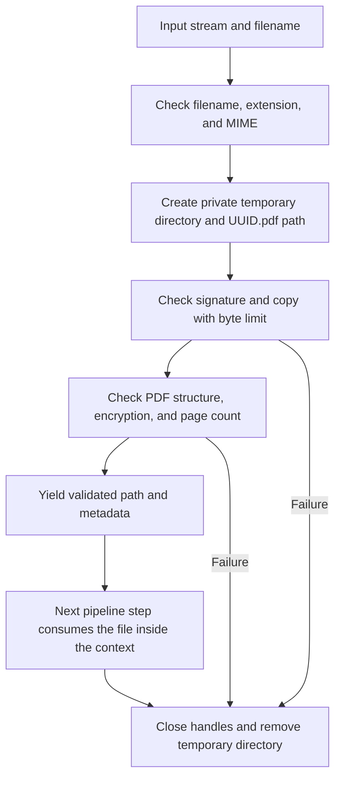

# Phase 1, step 1: Strict PDF validation

Implemented: 15 November 2026. Status: first step implemented; the remaining Phase 1 steps are pending.

## What this step delivers

The first Phase 1 point establishes the input boundary before text extraction. A reusable validator checks the supplied filename, MIME type, PDF signature, actual byte count, structural readability, encryption, and page count. Accepted input is staged under a generated UUID filename and remains available to the next pipeline step only while its context manager is open.

This increment provides an internal service and a local CLI. The document upload endpoint and ingestion lifecycle are not exposed yet. The CLI's `validated` result means the input passed these checks; it does not create a document record, queue a job, or extract text.

## Files added or changed

| File | Purpose |
| --- | --- |
| [validation.py](../../../apps/api/app/services/ingestion/validation.py) | `PDFValidator`, `ValidatedPDF`, stable validation errors, bounded copying, structural checks, and temporary-file cleanup. |
| [cli.py](../../../apps/api/app/services/ingestion/cli.py) | Local validation command that uses the existing application settings and emits JSON. |
| [services/__init__.py](../../../apps/api/app/services/__init__.py) | Declares the backend services package. |
| [ingestion/__init__.py](../../../apps/api/app/services/ingestion/__init__.py) | Declares the ingestion package and its current scope. |
| [test_pdf_validation.py](../../../apps/api/tests/unit/test_pdf_validation.py) | Real generated PDF fixtures, size/page boundaries, stream behavior, filename checks, encryption, and cleanup tests. |
| [test_pdf_validation_cli.py](../../../apps/api/tests/unit/test_pdf_validation_cli.py) | CLI success, invalid-PDF rejection, and missing-file behavior. |
| [pyproject.toml](../../../apps/api/pyproject.toml) and [uv.lock](../../../apps/api/uv.lock) | Add and lock the lightweight `pypdf` dependency; the resolved version is 7.1.0. |

`pypdf` reads PDF structure for this validation step. Layout-aware extraction with PyMuPDF4LLM belongs to step 2. No text extraction, OCR, embedding model, new database migration, or frontend change is part of this increment.

## Validation order and limits

| Order | Check | Behavior |
| --- | --- | --- |
| 1 | Filename | Require a nonempty basename of at most 255 characters; reject paths, control characters, and leading/trailing whitespace. |
| 2 | Extension | Require `.pdf`, case insensitive; a name such as `paper.pdf.exe` fails. |
| 3 | Declared MIME type | Require `application/pdf`, case insensitive; MIME parameters are accepted. The MIME claim is followed by independent byte checks. |
| 4 | Magic bytes | Require `%PDF-` at byte zero. Empty or disguised files fail before structural parsing. |
| 5 | Actual size | Copy in chunks up to 64 KiB. Accept at most `MAX_UPLOAD_MB * 1024 * 1024` bytes, with a hard ceiling of 20 MiB (20,971,520 bytes). Read at most one byte beyond the limit to detect overflow. |
| 6 | Structure and encryption | Open the staged PDF with `PdfReader(strict=True)`. Reject detected structural errors and all encrypted PDFs, including those with an empty user password. |
| 7 | Page count | Require at least one page and at most `MAX_PDF_PAGES`, with a hard ceiling of 100. Exactly 100 is accepted; 101 is rejected. |

The implementation uses binary megabytes for the guide's 20 MB setting. Existing typed settings can lower the size and page limits. The validator also rejects constructor limits outside 1-20 MiB and 1-100 pages. It counts bytes actually read instead of relying on declared upload sizes.

An empty page can pass this structural check. Detecting scanned or text-poor documents requires the extraction and character-density checks in subsequent Phase 1 steps. Structural validation does not extract or validate every content stream.

## Temporary storage and cleanup



The filename on disk is generated by the service, for example `8be8e668-3415-49af-8691-a6ca2d7d6770.pdf`. The original filename is never used as a filesystem path. Each validation gets a separate `research-pdf-*` temporary directory.

Linux uses the platform temporary directory, normally `/tmp`. Windows uses the system temporary directory, normally under `%TEMP%`. Tests can supply an isolated `temp_root`.

The context manager removes the staged file and its directory after successful use, validation rejection, input read failure, or an exception in the consuming step. The caller retains ownership of the source stream, and the source file is not changed. This cleanup applies to normal context exits and exceptions; abrupt process termination requires separate stale-file handling rather than a guarantee from `finally`.

## Use the service in the next pipeline step

```python
from app.core.config import load_settings
from app.services.ingestion.validation import PDFValidator

settings = load_settings()
validator = PDFValidator(
    max_upload_mb=settings.max_upload_mb,
    max_pdf_pages=settings.max_pdf_pages,
)

with open("paper.pdf", "rb") as source:
    with validator.validate(
        source,
        filename="paper.pdf",
        content_type="application/pdf",
    ) as pdf:
        print(pdf.page_count, pdf.size_bytes, pdf.checksum)
        # The future extractor consumes pdf.path here, before this context exits.
```

`ValidatedPDF` is an immutable result with the temporary `path`, `size_bytes`, `page_count`, and SHA-256 `checksum`. The checksum is calculated during the bounded copy. The input stream must be positioned at the beginning; it can be non-seekable and return short reads. The temporary path becomes invalid after leaving the inner `with` block.

The service is synchronous. Future async API integration should run file validation outside the event loop rather than performing blocking file I/O directly in an async route.

## Try it locally

From the project root in PowerShell:

```powershell
cd apps/api
uv sync --frozen
uv run python -m app.services.ingestion.cli '..\..\Agentic Research & Knowledge Assistant Implementation Guide (v2.0).pdf'
```

To validate another document:

```powershell
uv run python -m app.services.ingestion.cli 'C:\path\to\paper.pdf'
```

The command uses the existing root `.env` for typed settings. A running database, frontend, or model server is not required for this command; configuration still has to pass the same settings validation as the rest of the application. Local files do not carry a browser MIME header, so the CLI uses the service's `application/pdf` declaration and still verifies the bytes and structure.

A successful result looks like this; UUID, size, page count, and checksum depend on the input:

```json
{
  "status": "validated",
  "temporary_filename": "8be8e668-3415-49af-8691-a6ca2d7d6770.pdf",
  "size_bytes": 413203,
  "page_count": 17,
  "checksum": "<sha256 of input bytes>",
  "temporary_file_deleted": true
}
```

The command emits success only after the temporary file has been deleted. It returns exit code 0 for success, 2 for validation rejection, and 1 for input/storage or configuration failures. Argument errors also use argparse's exit code 2. Error JSON contains a stable code and safe message, without PDF contents, internal parser exceptions, or absolute storage paths.

## Error contract

`PDFValidationError` carries an `error_code`, safe message, and `status_code` for future API mapping. These are not currently HTTP responses because this step has no upload route.

| Error code | Intended HTTP status | Meaning |
| --- | --- | --- |
| `INVALID_FILENAME` | 400 | Missing, unsafe, or ambiguous filename. |
| `UNSUPPORTED_FILE_TYPE` | 415 | Extension is not `.pdf`. |
| `UNSUPPORTED_MEDIA_TYPE` | 415 | MIME type is not `application/pdf`. |
| `EMPTY_FILE` | 400 | No bytes were supplied. |
| `INVALID_PDF_SIGNATURE` | 415 | The first five bytes are not `%PDF-`. |
| `FILE_TOO_LARGE` | 413 | Actual input exceeds the configured byte limit. |
| `INVALID_PDF` | 400 | Structural reading failed. |
| `ENCRYPTED_PDF` | 422 | The PDF is encrypted. |
| `EMPTY_PDF` | 422 | No pages are present. |
| `PDF_PAGE_LIMIT_EXCEEDED` | 422 | Page count exceeds the configured maximum. |

The CLI additionally reports `FILE_IO_ERROR` for file/storage problems and `CONFIGURATION_ERROR` for invalid settings.

## Verification

Run focused tests from `apps/api`:

```powershell
uv run pytest -q tests/unit/test_pdf_validation.py tests/unit/test_pdf_validation_cli.py
uv run ruff check .
uv run ruff format --check .
uv run mypy
```

Recorded on 15 November 2026:

- 45 focused validation and CLI tests passed.
- The full backend suite passed all 65 tests with `RUN_DB_TESTS=1`, including the existing real PostgreSQL integration tests. The existing upstream Starlette/HTTPX deprecation warning remains nonblocking.
- Ruff lint and formatting passed; strict mypy passed for 18 source files.
- The supplied guide validated as a 413,203-byte, 17-page PDF; the CLI confirmed temporary-file deletion.

The focused suite covers exact size/page limits, filename traversal and control characters, misleading MIME declarations, invalid signatures, malformed and encrypted PDFs, lower configured limits, non-seekable streams, cleanup on failure, source preservation, and safe CLI errors.

Phase 1's full ingestion acceptance gate remains pending: representative extraction quality, scanned-PDF handling, text retention, and chunk provenance require the later steps.

Reference: [pypdf PdfReader documentation](https://pypdf.readthedocs.io/en/stable/modules/PdfReader.html) for strict reading, encryption detection, and page access.
