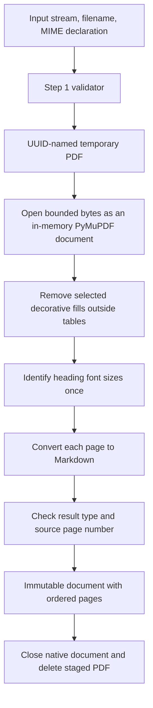

# Phase 1, step 2: Layout-aware PDF extraction

Implemented and verified: 15 November 2026. Status: step 2 implemented; scanned-PDF detection, normalization, chunking, and restart recovery remain pending.

Subsequent update: [step 3](phase-1-step-3-scanned-pdf-detection.md) now checks text density before layout conversion. Its behavior supersedes this step's original treatment of image-only pages as empty results. The sections below record the step 2 implementation and verification snapshot.

## Changes delivered

The ingestion service now validates an input PDF and extracts Markdown for each source page using PyMuPDF4LLM. The result retains page numbers and the exact Markdown returned by the adapter. Two-column text is read by layout rather than PDF drawing order, and detected tables are emitted as Markdown tables.

The local command supports `--extract` and an optional `--output` JSON file. Running it without those options keeps the validation-only behavior from step 1. This increment does not add an upload API or persist documents in PostgreSQL.

| File | Responsibility |
| --- | --- |
| [extraction.py](../../../apps/api/app/services/ingestion/extraction.py) | Immutable page/document results, geometric layout configuration, in-memory decorative-background handling, page-by-page Markdown conversion, and parser response checks. |
| [pipeline.py](../../../apps/api/app/services/ingestion/pipeline.py) | Composes validation and extraction inside the temporary-file context. |
| [errors.py](../../../apps/api/app/services/ingestion/errors.py) | Lightweight `PDFExtractionError` contract without importing the native parser. |
| [cli.py](../../../apps/api/app/services/ingestion/cli.py) | Adds extraction and UTF-8 JSON export while retaining validation-only usage. |
| [conftest_layout.py](../../../apps/api/tests/conftest_layout.py) | Generates small synthetic PDFs in memory for text, columns, tables, shaded code, headers/footers, blank pages, and image-only pages. |
| [test_pdf_extraction.py](../../../apps/api/tests/unit/test_pdf_extraction.py) | Tests real extraction, reading order, table cells, page boundaries, raw-text preservation, cleanup, and failure handling. |
| [test_pdf_validation_cli.py](../../../apps/api/tests/unit/test_pdf_validation_cli.py) | Adds extraction/export tests, Unicode output, overwrite protection, and safe failure results. |
| [pyproject.toml](../../../apps/api/pyproject.toml) and [uv.lock](../../../apps/api/uv.lock) | Add and lock PyMuPDF4LLM, PyMuPDF, and their dependencies. |

## How the pipeline works



`PDFIngestionService.extract()` accepts a binary stream, filename, and MIME declaration. It uses the existing validator first, so invalid input does not reach the layout parser. Extraction finishes inside the validator's context; the native document closes before the temporary PDF is deleted. Returned results contain no temporary path and remain usable after cleanup. The caller retains ownership of the input stream.

The parser opens the validated file's bytes in memory. Input size is already bounded to 20 MiB. This also avoids dependency-internal file handles retaining a Windows lock on the staged PDF after a parser failure.

## Layout and memory choices

The lockfile resolves PyMuPDF4LLM, PyMuPDF, and PyMuPDF Layout at version 2.1. The adapter explicitly selects PyMuPDF4LLM's geometric mode once when the extraction module loads. This analyzes columns, fonts, and table geometry without loading the ONNX layout model. The default model-backed mode encountered a native allocation failure on this development machine during testing, so it is not used by this adapter.

The installed dependencies still include ONNX Runtime and the layout package through their package requirements. Disabling model-backed layout avoids loading its model; it is not a claim that the dependencies are absent, or that production container memory has been benchmarked.

Heading font sizes are scanned once per document. Page conversion then reuses that information. The adapter requests one source page at a time, disables image writing and embedding, and processes the full page with zero margins. The selected geometric backend does not perform OCR. Headers and footers remain in the extracted Markdown for the later deterministic normalization step.

The library's per-page output is checked for exactly one result, a string `text` value, and a matching one-based source page identifier. Missing, malformed, or misnumbered output raises an error instead of silently dropping a page. Blank source pages remain in their original position, with the empty or whitespace Markdown returned by the parser.

## Shaded text and code blocks

The real-file smoke test found that geometric extraction could classify shaded text backgrounds as graphics and omit their text, including an entire code page. Ignoring all graphics would disable table detection, so the adapter handles a narrower case in its in-memory copy:

1. Find simple filled rectangles large enough to be text backgrounds, excluding almost-full-page background fills.
2. Identify actual table regions and text blocks.
3. Skip rectangles intersecting detected tables, and skip pages with existing redaction annotations.
4. Remove qualifying fills that overlap text using native graphics-only redaction settings. Text and images are explicitly retained.
5. Extract Markdown with table detection still enabled.

The original input and staged PDF bytes are never rewritten. This addresses the tested shaded-code case while retaining the table cells and rows in the regression fixtures. It is not a guarantee for every graphical or unusual PDF layout.

## Result contract

```python
@dataclass(frozen=True)
class ExtractedPage:
    page_number: int       # One-based physical PDF page number
    raw_text: str          # Exact extracted Markdown; no application normalization

@dataclass(frozen=True)
class ExtractedDocument:
    checksum: str          # SHA-256 of original input bytes
    size_bytes: int
    pages: tuple[ExtractedPage, ...]
    parser: str            # pymupdf4llm
    parser_version: str
```

`ExtractedDocument.page_count` is the length of `pages`. Pages are kept separately and in source order. There is no automatic page joining, header removal, whitespace stripping, or chunking of `raw_text`. These properties give the later chunker a stable per-page string for character offsets.

To use the service from backend code:

```python
from app.core.config import load_settings
from app.services.ingestion.pipeline import PDFIngestionService
from app.services.ingestion.validation import PDFValidator

settings = load_settings()
service = PDFIngestionService(
    validator=PDFValidator(
        max_upload_mb=settings.max_upload_mb,
        max_pdf_pages=settings.max_pdf_pages,
    )
)

with open("paper.pdf", "rb") as source:
    document = service.extract(source, filename="paper.pdf")

for page in document.pages:
    print(page.page_number, page.raw_text)
```

The service is synchronous. Future API/worker integration must account for PyMuPDF's process-level configuration and native-library concurrency constraints; this step does not introduce a public parsing route or parser isolation.

## Run the local command

From `apps/api`, install the updated lockfile:

```powershell
uv sync --frozen
```

Validate only, preserving the previous command:

```powershell
uv run python -m app.services.ingestion.cli 'C:\path\to\paper.pdf'
```

Extract and print page-separated JSON:

```powershell
uv run python -m app.services.ingestion.cli 'C:\path\to\paper.pdf' --extract
```

Or save extraction JSON to a new UTF-8 file:

```powershell
uv run python -m app.services.ingestion.cli 'C:\path\to\paper.pdf' --extract --output '.\pages.json'
```

The output directory must already exist. Existing output files are not overwritten, including if the selected output is the input PDF. With `--output`, stdout contains a short JSON success summary, while the file contains page Markdown and source metadata. Without `--output`, stdout contains the full result, with ASCII JSON escaping for compatibility with Windows console encodings. Decoding that JSON restores the original Unicode strings.

Successful output contains `status: "extracted"`, document metadata, `page_count`, `pages`, and `temporary_file_deleted: true`. `--output` requires `--extract`. Export is explicit: the service itself only returns an in-memory result and does not save extracted text on disk.

The command loads the existing typed settings from the root `.env`. It does not need a running database, frontend, Ollama server, or inference API.

## Error handling

Step 1 validation errors retain their existing codes. Parser failures produce `PDF_EXTRACTION_FAILED` with a safe message and the source page number when known. Internal parser exception strings, temporary paths, and PDF content are not included in this error response. The CLI returns exit code 2 for validation/extraction rejection, 1 for configuration or file I/O failures, and 0 for success.

Extraction failure occurs before an output file is opened, so those failures do not create a partial export. Existing output produces `OUTPUT_FILE_EXISTS`. Filesystem failures use the safe `FILE_IO_ERROR` result. Native dependency diagnostics are separate from application JSON logging; this step is intended for the local pipeline, ahead of parser isolation and public upload handling.

## Verification results

Recorded on 15 November 2026:

| Check | Result |
| --- | --- |
| Full backend suite, real PostgreSQL enabled | 85 tests passed. |
| Focused extraction and CLI tests | 23 cases passed before the final full-suite run. |
| Ruff lint and formatting | Passed; 30 Python files formatted. |
| Strict mypy | Passed for 21 application/migration source files. |
| Real guide extraction | 17/17 nonblank source pages preserved; 33,946 Markdown characters and 59 Markdown table lines. |
| Shaded code regression | Code remains present and the input bytes are unchanged. |
| Temporary-file lifecycle | Successful and failed extraction clean up the staged PDF; no image files are exported. |

The focused fixtures cover column reading order even when the right column is drawn first, table row/cell values, shaded text beside a table, shaded code, blank middle pages, header/footer retention, image-only pages without OCR, stable repeated extraction, exact raw whitespace, Unicode export, safe failures, and overwrite protection. The existing upstream Starlette/HTTPX TestClient deprecation warning remains nonblocking.

Run the checks from `apps/api`:

```powershell
uv run ruff check .
uv run ruff format --check .
uv run mypy
uv run pytest -q tests/unit/test_pdf_extraction.py tests/unit/test_pdf_validation_cli.py

# With PostgreSQL running and migrations applied:
$env:RUN_DB_TESTS = "1"
uv run pytest -q
Remove-Item Env:RUN_DB_TESTS
```

These are extraction smoke and regression results, not the full Phase 1 quality gate. A representative ten-paper corpus and the 98% text-retention benchmark remain pending. The next step is scanned-PDF detection; image-only pages currently remain as empty/whitespace page results for that detector to inspect.

References: [PyMuPDF4LLM API](https://pymupdf.readthedocs.io/en/latest/pymupdf4llm/api.html) and [PyMuPDF Document API](https://pymupdf.readthedocs.io/en/latest/document.html).
