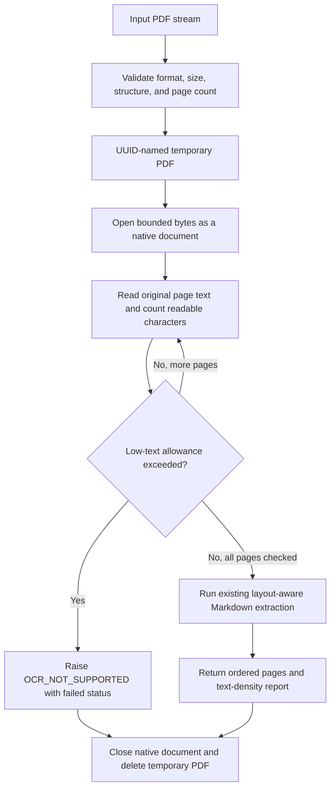

# Phase 1, step 3: Scanned-PDF detection

Implemented and verified: 15 November 2026. Status: step 3 implemented in the internal extraction pipeline and CLI. Normalization, chunking, and crash recovery are later steps.

## What changed

PDF extraction now checks each original page's text layer before font scanning, decorative-background handling, or Markdown conversion. A PDF is rejected with `status: "failed"` and `error_code: "OCR_NOT_SUPPORTED"` when too many pages have too little readable text.

Default policy:

- A page is low-text when it has **fewer than 50** printable, non-whitespace characters.
- Reject when low-text pages account for **more than 80%** of all PDF pages.
- Stop reading pages immediately once that whole-document allowance is exceeded.

This is a text-density heuristic. Image-only and blank PDFs fail it, and very short text-only PDFs can fail too. A scan with a sufficiently populated text layer does not fail this check merely because it also contains an image. The check does not perform OCR or classify page images visually.

## Files changed

| File | Responsibility |
| --- | --- |
| [detection.py](../../../apps/api/app/services/ingestion/detection.py) | `PDFTextDensityDetector`, immutable `TextDensityReport`, character counting, ratio checks, and early abort. |
| [errors.py](../../../apps/api/app/services/ingestion/errors.py) | Adds `OCRNotSupportedError`, safe diagnostics, and the shared failed-state contract. |
| [extraction.py](../../../apps/api/app/services/ingestion/extraction.py) | Runs density detection before layout work and includes the report in successful results. |
| [cli.py](../../../apps/api/app/services/ingestion/cli.py) | Loads configured thresholds and emits a failed JSON result with safe density diagnostics. |
| [config.py](../../../apps/api/app/core/config.py) | Validates the two optional policy settings. |
| [.env.example](../../../.env.example) | Documents the default settings without changing the existing local `.env`. |
| [test_pdf_text_density.py](../../../apps/api/tests/unit/test_pdf_text_density.py) | Tests strict boundaries, early abort, real rasterized text pages, mixed PDFs, metadata, and cleanup. |
| [test_pdf_extraction.py](../../../apps/api/tests/unit/test_pdf_extraction.py) | Updates the image-only expectation and checks density metadata and empty-output failure handling. |
| [test_pdf_validation_cli.py](../../../apps/api/tests/unit/test_pdf_validation_cli.py) | Tests failed status, safe error details, configured thresholds, and no export on rejection. |
| [test_config.py](../../../apps/api/tests/unit/test_config.py) | Tests invalid detection settings. |
| [conftest_layout.py](../../../apps/api/tests/conftest_layout.py) | Gives normal text fixtures enough source text to pass the default density policy. |

No dependency or database migration was needed for this step.

## How it works



Characters are counted from PyMuPDF's native text extraction, not the generated Markdown. Whitespace and non-printable control characters do not contribute. Printable Unicode characters do contribute. Markdown table borders, heading markers, code fences, and other generated formatting cannot increase the count.

The detector consumes a lazy page-text iterator and knows the total PDF page count from validation. It uses integer comparison:

```python
low_text_page_count * 100 > max_low_text_page_percent * total_page_count
```

The denominator is always the whole PDF, not the number of pages checked so far. Early rejection is safe because the low-text count cannot decrease when later pages are read.

| Example with default settings | Outcome |
| --- | --- |
| One page with 49 readable characters | Fail: the page is low-text, so 100% of pages are low-text. |
| One page with exactly 50 readable characters | Pass: exactly 50 is sufficient. |
| Five pages, four low-text and one sufficiently populated | Pass: exactly 80% is allowed. All five source page positions remain present. |
| Ten pages, first nine low-text | Fail at page nine. Reading page ten cannot bring nine low-text pages back below the allowance of eight. |
| Three pages, one blank and two sufficiently populated | Pass, with the blank page included in the report and extraction result. |

If the declared page count disagrees with the supplied text stream, the detector raises a generic extraction error rather than producing a misleading density result.

## Settings

The existing root `.env` does not need new values: defaults are built into typed settings. Optional overrides are:

```dotenv
MIN_TEXT_CHARS_PER_PAGE=50
MAX_LOW_TEXT_PAGE_PERCENT=80
```

`MIN_TEXT_CHARS_PER_PAGE` accepts integers from 1 to 10,000. `MAX_LOW_TEXT_PAGE_PERCENT` accepts integers from 0 to 99, so a policy cannot completely disable rejection of entirely text-poor PDFs by setting 100%. Invalid settings fail through the existing sanitized startup/configuration guard.

The CLI passes these settings to the detector. Direct service use defaults to 50 and 80; backend callers can inject another validated policy explicitly:

```python
from app.services.ingestion.detection import PDFTextDensityDetector
from app.services.ingestion.extraction import PDFMarkdownExtractor
from app.services.ingestion.pipeline import PDFIngestionService

service = PDFIngestionService(
    extractor=PDFMarkdownExtractor(
        text_detector=PDFTextDensityDetector(
            min_text_chars_per_page=50,
            max_low_text_page_percent=80,
        )
    )
)
```

## Successful result

`ExtractedDocument` now includes an immutable `text_density` report:

```json
{
  "text_char_counts": [156, 0, 207],
  "low_text_page_numbers": [2],
  "min_text_chars_per_page": 50,
  "max_low_text_page_percent": 80
}
```

Counts follow source page order and page numbers are one-based. The report does not modify `pages[].raw_text`; Markdown and whitespace remain unchanged after extraction. The report is included automatically in the CLI's successful JSON export.

If a page has substantial native text but the Markdown parser returns an empty string, that is reported as `PDF_EXTRACTION_FAILED`, not `OCR_NOT_SUPPORTED`. This distinguishes a parser content-loss failure from an insufficient text layer.

## Failure contract and cleanup

`OCRNotSupportedError` extends `PDFExtractionError` and carries:

- `status = "failed"`
- `error_code = "OCR_NOT_SUPPORTED"`
- `status_code = 422` for future HTTP mapping
- The total page count, number checked before rejection, low-text page numbers observed, and thresholds.

The CLI returns exit code 2 and JSON such as:

```json
{
  "status": "failed",
  "error_code": "OCR_NOT_SUPPORTED",
  "message": "This PDF has too little extractable text. Upload a text-based PDF; OCR is not supported.",
  "page_number": 9,
  "text_density": {
    "total_pages": 10,
    "checked_pages": 9,
    "low_text_page_numbers": [1, 2, 3, 4, 5, 6, 7, 8, 9],
    "min_text_chars_per_page": 50,
    "max_low_text_page_percent": 80
  }
}
```

`page_number` identifies the source page where rejection became certain. No PDF content or temporary path is included. The exception propagates through the existing native-document and validation contexts, so the staged PDF is removed. Rejection happens before the output file is opened; no extraction JSON file is created on this failure.

The project currently has an internal pipeline and local CLI, with no persistent `Document` table or upload job lifecycle. Therefore `failed` is the typed failure/CLI status at this stage, not a database row update. Future document/job integration must persist this status and error code when those records are introduced.

Validation-only mode still checks the file format and limits. Density detection applies to the extraction pipeline, so `--extract` is required to exercise it from the CLI.

## Run and verify

From `apps/api`, the command stays the same:

```powershell
uv run python -m app.services.ingestion.cli 'C:\path\to\paper.pdf' --extract
```

For an accepted text-based PDF, optionally add `--output '.\new-pages.json'`. For an image-only or predominantly text-poor PDF, the command returns the failed JSON above. No OCR engine or inference provider is called.

Tests and quality checks:

```powershell
uv run pytest -q tests/unit/test_pdf_text_density.py tests/unit/test_pdf_extraction.py tests/unit/test_pdf_validation_cli.py tests/unit/test_config.py
uv run ruff check .
uv run ruff format --check .
uv run mypy
uv run pytest -q
```

Recorded on 15 November 2026:

| Check | Result |
| --- | --- |
| Full backend suite | 116 passed; two database integration tests skipped. |
| Ruff lint and formatting | Passed; 32 Python files formatted. |
| Strict mypy | Passed for 22 application/migration source files. |
| Real guide extraction | 17 pages accepted; minimum readable text count 748; no low-text pages; temporary PDF deleted. |
| Rasterized text PDF | Rejected with `OCR_NOT_SUPPORTED` before layout analysis or OCR. Ten-page input aborts after page nine. |
| Boundary cases | 49 versus 50 characters; 80% versus greater than 80%; 100-page integer ratio; mixed and blank pages. |
| Cleanup and export | Failure removes temporary files, leaves the source stream open, and creates no extraction export. |

The two existing PostgreSQL integration cases were not enabled for this run because Docker's engine was unavailable. The existing upstream Starlette/HTTPX TestClient deprecation warning remains nonblocking. No public API, production deployment, or representative-corpus accuracy result is claimed for this increment.

Next: Phase 1 step 4, deterministic normalization of repeated headers and footers while preserving raw Markdown for citation offsets.
