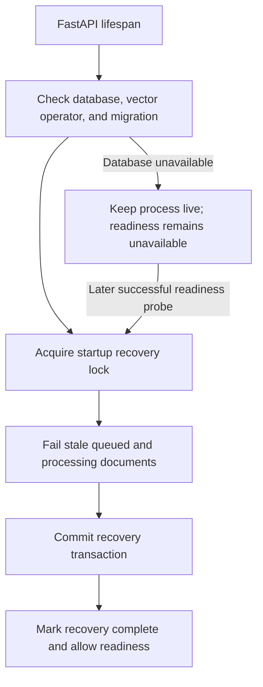

# Phase 1, step 6: Crash-safe lifespan recovery

Implemented and verified: 16 November 2026. Durable document status and startup recovery are now backed by PostgreSQL.

## Database changes

[Migration 0002](../../../apps/api/migrations/versions/0002_documents.py) creates `documents`, with UUID identity, session UUID/sample flag, filename/checksum, status, page count, error code, expiry, and timezone-aware creation/update timestamps. A status/update-time index supports recovery. Constraints limit status to `queued`, `processing`, `ready`, or `failed`, require an owner for non-sample records, and validate page counts.

[models.py](../../../apps/api/app/db/models.py) registers the SQLAlchemy model with Alembic metadata. `updated_at` is refreshed by ORM updates and can serve as the future worker's heartbeat. Session UUIDs are metadata at this stage; public upload routes, cookie isolation, expiry cleanup, and vector/chunk indexes are not implemented by this migration.

Readiness now expects revision `0002_documents`. For another checkout or database, apply the migration before restarting the API:

```powershell
cd apps/api
uv sync --frozen
uv run alembic upgrade head
uv run uvicorn app.main:app --reload --host 127.0.0.1 --port 8000 --no-access-log
```

The migration was applied to the local project database and `alembic check` reported no pending model operations. Migrations remain explicit; starting the API does not apply them automatically.

## Recovery rule

[recovery.py](../../../apps/api/app/workers/recovery.py) performs a single transactional update:

```text
WHERE status IN ('queued', 'processing')
  AND updated_at < database_transaction_time - 5 minutes

SET status = 'failed',
    error_code = 'INTERRUPTED_BY_RESTART',
    updated_at = database_transaction_time
```

The comparison is strictly older than five minutes. Exactly five minutes is retained. Fresh queued/processing work and terminal `ready`/`failed` records remain unchanged. The last-update timestamp matters, so future ingestion workers must keep it current during active processing. Existing errors on terminal failures are preserved.

The function accepts an `AsyncSession`; the caller owns the transaction. The database startup path commits recovery before marking it complete. Repeating the update is idempotent because recovered rows are no longer in an active status.

## Lifespan behavior

FastAPI's existing lifespan calls `Database.check()`. That check verifies PostgreSQL, pgvector operations, and the migration revision, then ensures recovery has completed once for that database instance.



An async lock prevents simultaneous startup/readiness probes from running recovery more than once. The initial probe connection is released before the recovery transaction opens, avoiding pool starvation under concurrent readiness requests. Later health checks verify dependencies but do not repeatedly fail jobs that become old during the same process lifetime.

If startup cannot reach the database or recovery fails, completion remains false. A later successful readiness check can retry and commit recovery. Liveness is independent of this database work. A new API process gets a new recovery state and scans again.

The application emits `startup.ingestion_recovery_completed` with a numeric `recovered_documents` count. JSON logging permits that count without logging filenames, document text, session IDs, or individual document IDs.

## Current integration boundary

Recovery operates on actual persisted `Document` rows and is tested through FastAPI lifespan startup. Local `--prepare` still produces an in-memory/explicit JSON result; it does not enqueue a database job or persist chunks. Future upload/job integration must create/update these document rows, persist typed failures such as `OCR_NOT_SUPPORTED`, and supply the existing document UUID to preparation.

No upload or research endpoint is exposed by this step, and no long-running ingestion worker is launched.

## Verification

[Recovery integration tests](../../../apps/api/tests/integration/test_recovery.py) use real PostgreSQL to verify:

- Stale queued and processing rows become failed with `INTERRUPTED_BY_RESTART`.
- Exactly-five-minute, fresh, ready, and previously failed rows are preserved.
- A second update is idempotent.
- FastAPI startup commits the failed state, visible from another connection.
- Ordinary health checks do not repeat recovery; a new database/process instance does.
- Twelve concurrent readiness checks complete without pool starvation and run recovery once.

The unit/general suite passed 141 tests, with the six database tests reserved for a separate run. All six real PostgreSQL tests then passed, including the existing readiness/vector checks. Total: 147 distinct tests passed across the two runs. Ruff lint/format passed for 48 Python files and strict mypy passed for 33 application/migration files.

Windows virtual-memory pressure required running the unit and database suites separately. The database-only command avoids loading the PDF fixture plugin:

```powershell
$env:RUN_DB_TESTS = "1"
uv run pytest -q --noconftest tests/integration
Remove-Item Env:RUN_DB_TESTS
```

Normal CI can continue running `RUN_DB_TESTS=1 uv run pytest -q` with its PostgreSQL service. The existing upstream Starlette/HTTPX warning remains nonblocking. The full Phase 1 representative ten-paper parsing and labelled text-retention benchmark is still pending; implementation-step verification is not that corpus acceptance claim.
