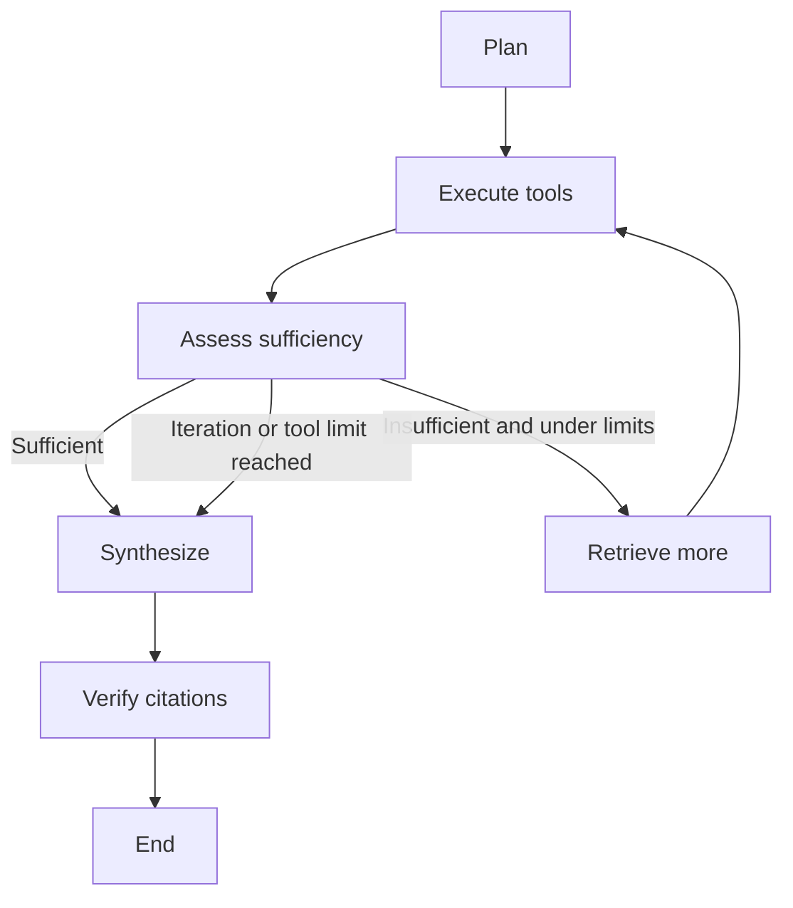

# Phase 6, step 2: Research graph topology

The compiled LangGraph coordinates planning, tool execution, sufficiency checks,
optional additional retrieval, report synthesis, and citation verification. Runtime
operations are injected into the graph so the topology can be tested without live
LLM calls or database writes. Step 3 provides the scoped read-only tool registry.



Iterations count each tool-execution round. More retrieval is not scheduled when
four rounds or six recorded tool calls have been reached. If evidence remains
insufficient at that point, the report is explicitly marked as partial and receives
a coverage disclaimer. Evidence is merged by chunk ID so repeated retrieval cannot
duplicate a source in the report state.

## Golden-data verification

From `apps/api`:

```powershell
uv run pytest -q tests/unit/test_research_graph.py
```

The graph executes against every one of the 40 Phase 3 golden questions with
deterministic operations. The tests verify the ordered node trace, evidence
deduplication, sufficient-evidence exit, and partial synthesis after the fourth
round. These are orchestration tests, not live-model quality results.

## Visual example

Open this guide in a Markdown preview to view the rendered graph above. For a
valid example using the golden question *“Which five benchmarks are used to
evaluate the educational question-answering system?”*, the expected completed
progress trace is:

```text
plan
execute_tools
assess_sufficiency
retrieve_more
execute_tools
assess_sufficiency
synthesize
verify_citations
```

Step 5 exposes the same ordered trace in the persisted job's `steps[]` response,
where it can be inspected visually in Swagger or the local research page.

## Source

- `apps/api/app/services/research/graph.py` — graph topology, state transitions,
  evidence de-duplication, and bounded routing.
- `apps/api/tests/unit/test_research_graph.py` — golden-query and iteration-boundary
  verification.
