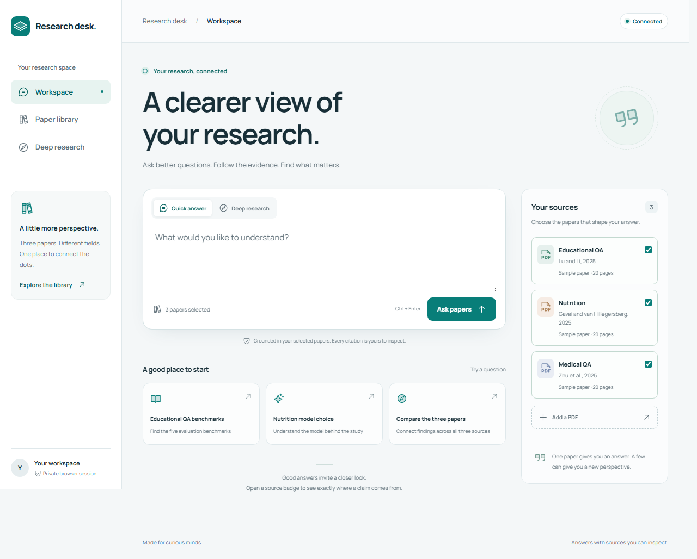

# Phase 7: Frontend and user experience

Phase 7 follows the v2.0 implementation guide. Its goal is an intuitive demo
workspace for first-time visitors and technical reviewers.

| Step | Status | Guide |
| --- | --- | --- |
| 1. Cold-start wake-up banner | Implemented | [Step 1](phase-7-step-1-cold-start.md) |
| 2. Zero-friction sample workspace | Implemented | [Step 2](phase-7-step-2-sample-workspace.md) |
| 3. Interactive citation drawer | Implemented | [Step 3](phase-7-step-3-citation-drawer.md) |
| 4. Live agent timeline | Implemented | [Step 4](phase-7-step-4-live-timeline.md) |

The first-visit path, citation inspection, multi-document timeline, and quota /
sleeping-backend feedback are implemented. The responsive browser check exposed
and fixed a narrow-screen header overflow; final exact-width checks are recorded
in the step guides.

## Completion work, 23 November 2026

The workspace now includes a navigation rail, teal/white design system, locally
bundled Manrope typography and Phosphor icons, an answer/research mode switch,
a selected-source panel, and a working private PDF library. Effects include
answer reveals, modal drawer transitions, input/selection feedback and loading
skeletons. Reduced motion is respected; decoration never invents research activity.

The missing upload path is implemented. `POST /api/v1/documents?filename=...`
accepts raw PDF bytes through the existing validation/extraction/embedding/indexing
pipeline. `GET /api/v1/documents` lists ready samples and current-session unexpired
papers. Limits remain20 MiB/100 pages, with typed OCR errors. A single app-owned
worker serializes native parsing and closes running/queued streams safely.

The source drawer verifies Unicode code-point quote ranges before highlighting,
traps focus, restores the actual inline badge, and shows private filenames. The
answer and research views distinguish insufficiency, provider fallback, request
errors and terminal job failures. Markdown HTML/unsafe links stay filtered.

The default API origin is the app's own origin. Next proxies `/api/v1` to
`API_INTERNAL_URL` (default `http://127.0.0.1:8000`), preserving cookies on both
localhost and 127.0.0.1. Proxy limits support the advertised upload/request budgets.
Database port15432 replaces the Windows-reserved 55432; the data volume is retained.

See [design and plan](design-and-plan.md) and [verification](verification.md) for
files, tests, screenshots and limits. Mocked browser answers do not establish live
model quality or replace earlier phase quality evaluations.

## Run and check

Follow root `runGuide.txt`, then open `http://localhost:3000`. The starter questions
work without upload. Add searchable PDFs from **Paper library**.

From `apps/web`:

```powershell
npm run lint
npm run typecheck
npm run format:check
npm run test:e2e
npm run test:proxy
npm run build
```

The proxy test starts an isolated Next instance on 3101 and a synthetic upstream
on 18005. It actually forwards12 MiB and waits for a 35-second response. API/database
tests: `$env:RUN_DB_TESTS='1'; uv run pytest -q` from `apps/api`.

## Final checks

375 API/database tests,16 frontend checks and 2 real-proxy checks passed. Lint,
format, types and the production build pass. A real hosted-answer smoke through
the app returned a correct cited answer. See [verification](verification.md) for
exact methods and remaining limits. No Phase 7 implementation step remains blocked.


